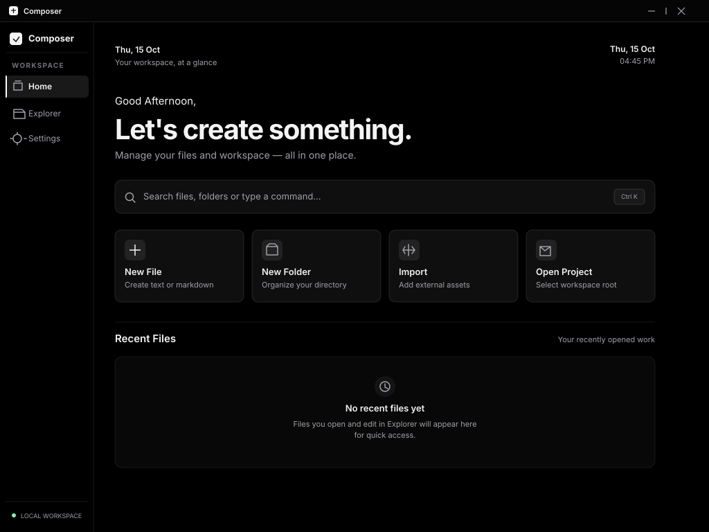
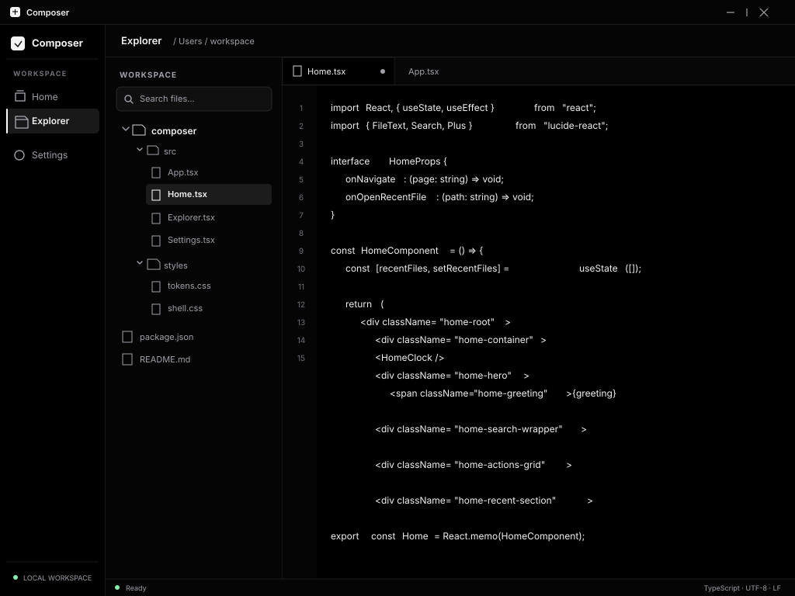

<div align="center">


# Composer

**A focused desktop workspace for your files.**

Create, inspect, and edit code, documents, vectors, images, and data — in one minimal, local-first app.

<br />

[](https://tauri.app/)
[](https://react.dev/)
[](https://www.typescriptlang.org/)
[](https://www.rust-lang.org/)

<br />

[**Download**](https://github.com/zishan049/Composer/releases/latest) · [**Features**](#what-you-can-do) · [**Build from source**](#run-locally) · [**Report an issue**](https://github.com/zishan049/Composer/issues)

</div>

---

## A workspace that stays out of the way

Composer brings everyday creative and technical file workflows into a single desktop application. Instead of switching between separate tools to inspect a document, edit code, preview an SVG, or review an image, work from one consistent workspace.

- **Local-first by design** — work with files on your machine.
- **One focused interface** — a compact shell and familiar navigation across tools.
- **Your preferred setup** — customize themes, typography, accents, and navigation.

## The interface

<table>
  <tr>
    <td width="50%">
      <strong>Home dashboard</strong><br />
      <sub>Search, quick actions, and recent work.</sub><br /><br />
      
    </td>
    <td width="50%">
      <strong>Code workspace</strong><br />
      <sub>File tree, editor tabs, and source editing.</sub><br /><br />
      
    </td>
  </tr>
</table>

> **Screenshot note:** These are source-derived UI previews based on the current React components and CSS design tokens. They communicate the intended layout, but are not pixel captures from a running application.

## What you can do

| Tool | Capabilities |
| --- | --- |
| **Code** | Monaco-based editing, syntax highlighting, multi-tab workflows, and Vim keybindings. |
| **Markdown** | Write and preview Markdown with code, split, and preview modes. |
| **PDF** | View PDFs and edit supported text on the document canvas. |
| **SVG** | Inspect vector files, edit SVG/XML source, and preview changes. |
| **Images** | Zoom, rotate, flip, inspect metadata, and sample pixel colors. |
| **Structured data** | Work with supported CSV and other data files in text or grid views. |
| **Workspace** | Browse folders, search files, revisit recent work, and create or import items. |
| **Appearance** | Adjust themes, typography, accent colors, and navigation layouts. |

## Get Composer

### Windows

Download the latest available installer from **[GitHub Releases](https://github.com/zishan049/Composer/releases/latest)**.

1. Open the latest release.
2. Download the Windows `.exe` installer from its assets.
3. Run the installer and launch Composer.

If no release assets are available, build the application from source using the steps below.

## Run locally

### Requirements

- Node.js (20 or 22 recommended)
- npm
- Rust and Cargo
- Platform-specific prerequisites from the [Tauri setup guide](https://tauri.app/start/prerequisites/)

### Development build

```bash
git clone https://github.com/zishan049/Composer.git
cd Composer
npm install
npm run tauri dev
```

### Production build

```bash
npm run tauri build
```

Tauri bundle artifacts are typically generated under `src-tauri/target/release/bundle/`.

## Keyboard shortcuts

| Shortcut | Action |
| --- | --- |
| `Ctrl/Cmd + K` | Open quick search |
| `Ctrl/Cmd + S` | Save the active document |
| `Ctrl/Cmd + F` | Focus file search where supported |
| `F11` | Toggle fullscreen |
| `Esc` | Close the active dialog or overlay |

Shortcut behavior may vary by view and operating system.

## Technology

| Layer | Stack |
| --- | --- |
| Desktop shell | Tauri 2 |
| Native backend | Rust |
| UI | React 19 + TypeScript |
| Build | Vite 7 |
| Styling | Tailwind CSS 4 and modular CSS |
| Code editor | Monaco Editor |
| PDF | PDF.js and pdf-lib |

## Repository layout

```text
Composer/
├── .github/          # CI and release workflows
├── public/           # Static assets
├── docs/screenshots/ # README UI previews
├── src/
│   ├── components/   # Home, Explorer, Settings, and studio views
│   ├── styles/       # Design tokens and component styling
│   ├── utils/        # Shared utilities
│   ├── App.tsx       # App shell and navigation
│   └── types.ts      # Shared TypeScript types
├── src-tauri/
│   └── src/          # Rust commands and native integrations
├── PRD.md            # Product requirements
└── package.json
```

## Project status

- [x] Desktop shell and workspace navigation
- [x] Local file browsing and quick search
- [x] Code, Markdown, PDF, SVG, image, and structured-data workflows
- [x] Theme and navigation customization
- [ ] Replace source-derived previews with screenshots captured from the running app
- [ ] Expand automated testing and cross-platform release coverage

## Contributing

Bug reports, feature ideas, and focused improvements are welcome.

1. Search [existing issues](https://github.com/zishan049/Composer/issues) before opening a new one.
2. For bugs, include your operating system, reproduction steps, and expected behavior.
3. Keep changes focused and consistent with the project's minimal, local-first direction.

## Privacy

Composer is designed around local file workflows. Optional capabilities such as update checks or dynamically loaded fonts may require network access. Consult the source and the behavior of the build you install if you need to verify a specific privacy or security property.

## License

See [LICENSE](LICENSE) for licensing terms.

---

<div align="center">

**Made for focused work. Built to stay out of the way.**

[⭐ Star Composer on GitHub](https://github.com/zishan049/Composer)

</div>
