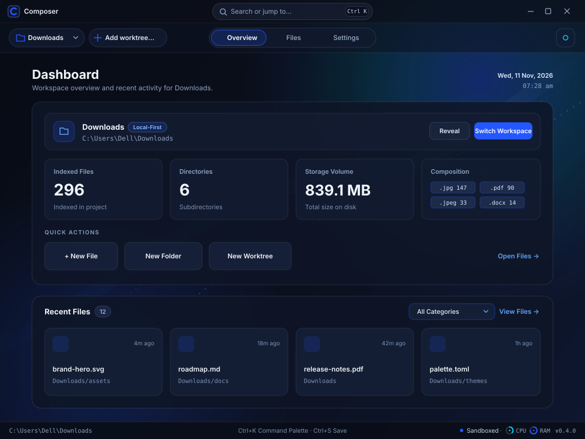
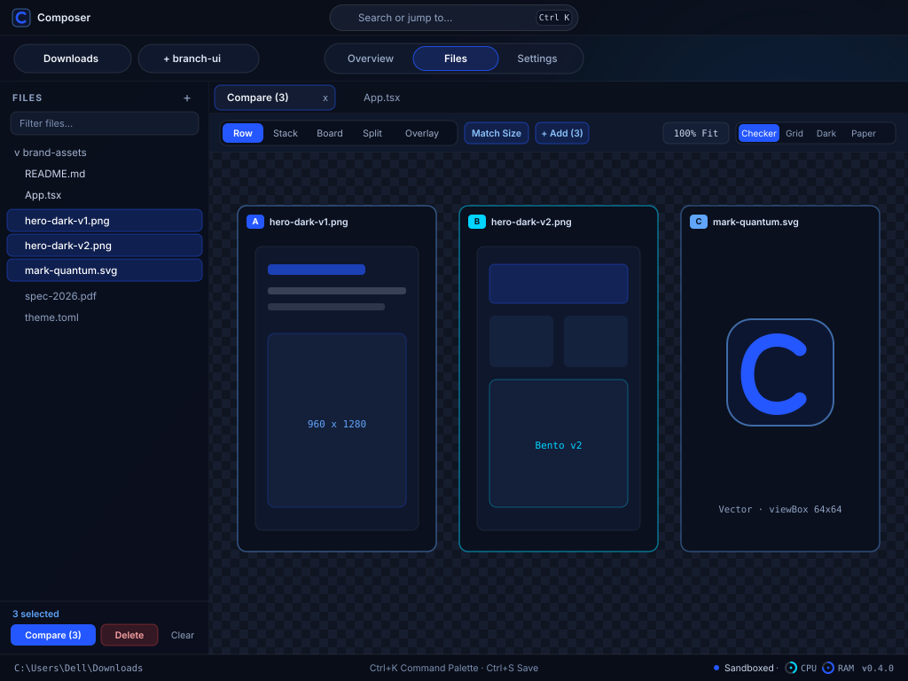

<div align="center">


# Composer

**A focused desktop workspace for your files.**

Create, inspect, compare, and edit code, documents, vectors, images, and structured data — in one minimal, local-first app (`v0.4.0`).

<br />

[](https://tauri.app/)
[](https://react.dev/)
[](https://www.typescriptlang.org/)
[](https://www.rust-lang.org/)

<br />

[**Download**](#get-composer) · [**Features**](#what-you-can-do) · [**Build from source**](#run-locally) · [**Report an issue**](https://github.com/zishan049/Composer/issues)

</div>

---

## A workspace that stays out of the way

Composer brings everyday creative and technical file workflows into a single sandboxed desktop workspace. Instead of juggling separate apps to edit source code, preview Markdown, inspect vectors, or compare multiple images side by side, work cleanly from one focused shell.

- **Local-first and strictly sandboxed** — files stay on your machine inside canonicalized workspace roots with `..` traversal guards, atomic saves, and session-scoped imports.
- **Three streamlined views + Command Palette** — move between **Overview**, **Files**, and **Settings** through a glassmorphic Top or Bottom Navbar, or press **`Ctrl/Cmd + K`** anywhere to search and act at keyboard speed.
- **Git-free worktrees** — create, rename, and switch isolated worktrees (`<workspace>/.composer/worktrees.json`) or scaffold nested `composer.toml` workspaces directly from Explorer without touching Git.
- **Quantum Blue & Ghost Fiber setup** — personalize dark/light Quantum Blue palettes, live **Ghost Fibers** ambient canvas ribbons, typography presets, edge smoothness sliders, **GlideSelect** menus, and TOML theme profiles.

## The interface

<table>
  <tr>
    <td width="50%">
      <strong>Workspace overview</strong><br />
      <sub>Unified hero metrics, quick actions, and category-filtered recent files.</sub><br /><br />
      
    </td>
    <td width="50%">
      <strong>Files &amp; unified media compare</strong><br />
      <sub>Explorer tree, tabs, and shared multi-image / SVG compare canvas.</sub><br /><br />
      
    </td>
  </tr>
</table>

> **Screenshot note:** These are source-derived UI previews based on the current `flash` branch React components, Quantum Blue tokens, and Ghost Fiber visuals. They communicate the layout, rather than pixel captures from a running binary.

## What you can do

| Tool | Capabilities |
| --- | --- |
| **Code** | Lazy-loaded Monaco Editor with self-hosted workers, syntax highlighting, multi-tab dirty-state guards, and atomic writes. |
| **Markdown** | Write and preview Markdown across **Preview**, **Split**, and **Code** modes with print &amp; PDF/document export dialog (`Ctrl/Cmd + P`). |
| **PDF** | Render pages with PDF.js (`pdfjs-dist`) and inspect or edit supported text using `pdf-lib`. |
| **SVG** | Inspect vector graphics interactively with zoom, preview/split/code views, and live XML source editing. |
| **Images** | Zoom, fit, rotate, flip, inspect image metadata, and sample pixel colors with the built-in eyedropper. |
| **Media Compare** | Compare multiple images and SVGs in one shared canvas using **Row**, **Stack**, **Board**, draggable A/B **Split**, and **Overlay** blend modes with synced zoom/pan and backdrop switching. |
| **Structured data** | Open `.csv`, `.json`, and `.toml` files cleanly in paginated table or source views. |
| **Worktrees &amp; Workspace** | Browse trees, multi-select files (`Ctrl + A`), import external assets, restore local version snapshots, search deterministically (`Ctrl/Cmd + K`), and organize Git-free worktrees. |
| **Appearance &amp; Telemetry** | Customize **Ghost Fibers** animation, glassmorphic Top/Bottom navbars, fonts, edge roundness, TOML theme export/import, and monitor live **CPU** &amp; **RAM** circular progress rings updating every 15 seconds. |

## Get Composer

Download the latest installers from **[GitHub Releases](https://github.com/zishan049/Composer/releases/latest)**.

### Windows

1. Open the latest release assets.
2. Download the Windows **`.exe`** (NSIS) installer.
3. Run the installer and launch Composer.

### Linux

1. Open the latest release assets.
2. Download the **`.AppImage`** (portable executable — run `chmod +x` before launching) or **`.deb`** package (Debian/Ubuntu).
3. Launch Composer from your terminal or desktop menu.

If prebuilt assets are not yet published for your architecture, build from source using the steps below.

## Run locally

### Requirements

- **Node.js** (v20 or v22 recommended) &amp; **npm**
- **Rust** stable &amp; **Cargo** (`rustfmt` and `clippy` components for CI checks)
- Platform prerequisites from the [Tauri setup guide](https://tauri.app/start/prerequisites/) (on Debian/Ubuntu Linux for Tauri v2: `libwebkit2gtk-4.1-dev`, `libayatana-appindicator3-dev`, `librsvg2-dev`, `libxdo-dev`, `libssl-dev`, `build-essential`, `patchelf`, `xdg-utils`)

### Development build

```bash
git clone -b flash https://github.com/zishan049/Composer.git
cd Composer
npm install
npm run tauri dev
```

### Verification checks

Run the same checks enforced by [`.github/workflows/ci.yml`](.github/workflows/ci.yml):

```bash
npx tsc --noEmit
npm test
cargo fmt --manifest-path src-tauri/Cargo.toml -- --check
cargo test --manifest-path src-tauri/Cargo.toml
cargo clippy --manifest-path src-tauri/Cargo.toml -- -D warnings
```

### Production build

```bash
npm run tauri build
```

Platform bundles are generated under `src-tauri/target/release/bundle/`.

## Keyboard shortcuts

| Shortcut | Action |
| --- | --- |
| `Ctrl/Cmd + K` | Open Command Palette &amp; workspace quick search |
| `Ctrl/Cmd + F` | Focus Explorer / Home filter search |
| `Ctrl/Cmd + S` | Save the active file (atomic write) |
| `Ctrl/Cmd + W` | Close active editor tab |
| `Ctrl/Cmd + N` | Create new file |
| `Ctrl/Cmd + A` | Select all files in Explorer |
| `F2` | Rename selected item or active tab |
| `Delete` | Delete selected item(s) with confirmation |
| `F11` | Toggle fullscreen |
| `Esc` | Close menus, pickers, dialogs, or Command Palette |

Image Viewer also supports `Ctrl + +/-/0/1` zoom, `R` / `Shift+R` rotate, `H` / `V` flip, and `I` eyedropper; `Mouse Back / Forward` steps across top-level pages.

## Technology

| Layer | Stack |
| --- | --- |
| Desktop shell | Tauri 2 (`@tauri-apps/api`, dialog, opener, process, updater plugins) |
| Native backend | Rust 2021 (`serde`, `serde_json`, `toml`, `sys-info`, `base64`) |
| UI Framework | React 19 + TypeScript 5.8 (Strict) |
| Build Tool | Vite 7 |
| Styling &amp; Motion | Tailwind CSS 4, CSS design tokens, `GhostFibers`, `GlideSelect` |
| Icons | `lucide-react` &amp; `@hugeicons/react` |
| Code Editor | Monaco Editor (lazy-loaded with self-hosted workers) |
| Previews &amp; PDF | PDF.js (`pdfjs-dist`), `pdf-lib`, `marked`, `DOMPurify` |

## Repository layout

```text
Composer/
├── .github/workflows/   # CI validation & cross-platform Windows/Linux release workflows
├── docs/screenshots/    # Source-derived SVG UI previews
├── public/              # Static assets and Composer SVG app mark
├── src/
│   ├── components/      # Home, Explorer, Settings, MediaCompareViewer, WorktreeManager, GhostFibers, GlideSelect
│   ├── lib/             # Typed Tauri IPC API (api.ts), WorktreeContext, DirtyStateContext, Monaco setup
│   ├── styles/          # Design tokens and view/shell CSS layers
│   ├── utils/           # Theme, fonts, recent files, and updater helpers
│   ├── App.tsx          # App shell, glassmorphic navigation, loading reveal & telemetry rings
│   └── types.ts         # Shared TypeScript interfaces
├── src-tauri/
│   ├── icons/           # Cross-platform .png, .icns, and .ico bundle icons
│   └── src/             # Sandboxed file_ops, worktrees, session allowlist, config & native commands
├── tests/               # Node unit tests for search, stats, and workspace lifecycle
├── PRD.md               # Product requirements
└── package.json
```

## Project status

- [x] Frameless glassmorphic desktop shell, Quantum Blue dark/light themes, and Ghost Fibers canvas
- [x] Local sandboxed file browsing, atomic writes, and deterministic Command Palette search
- [x] Unified Bento Overview dashboard with **GlideSelect** controls
- [x] Git-free named **Worktrees** and nested `composer.toml` workspaces
- [x] Unified Multi-Image / SVG Compare Workspace alongside Code, Markdown, PDF, and structured-data views
- [x] Native 15-second circular CPU &amp; RAM telemetry meters
- [x] Cross-platform Windows (`.exe`) and Linux (`.deb`, `.AppImage`) CI/release configuration
- [ ] Replace source-derived SVG previews with live binary captures

## Contributing

Bug reports, feature ideas, and focused improvements are welcome.

1. Search [existing issues](https://github.com/zishan049/Composer/issues) before opening a new one.
2. For bugs, include your operating system (Windows or Linux), reproduction steps, and expected behavior.
3. Run the CI checks (`npx tsc --noEmit`, `npm test`, `cargo fmt --check`, `cargo test`, `cargo clippy`) before submitting changes.

## Privacy

Composer is designed around local file workflows — editing, indexing, search, comparison, and worktree management run offline on your machine. Optional GitHub Releases update checks (configured in **Settings**) and Google Fonts stylesheet links (`index.html`) are the only network requests.

## License

Licensing terms will be specified upon public release. All rights reserved.

---

<div align="center">

**Made for focused work. Built to stay out of the way.**

[Star Composer on GitHub](https://github.com/zishan049/Composer)

</div>
